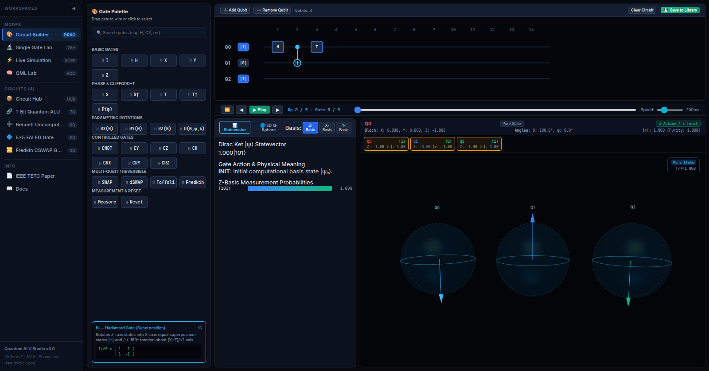
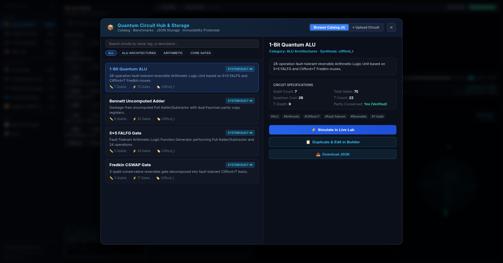
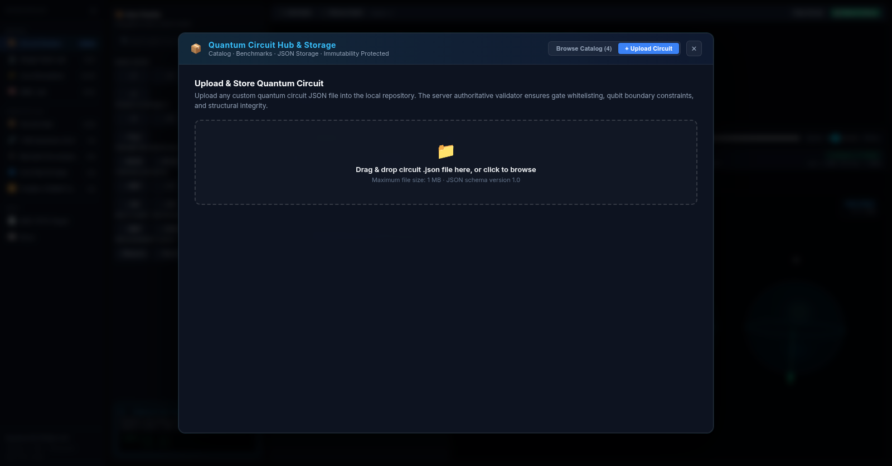
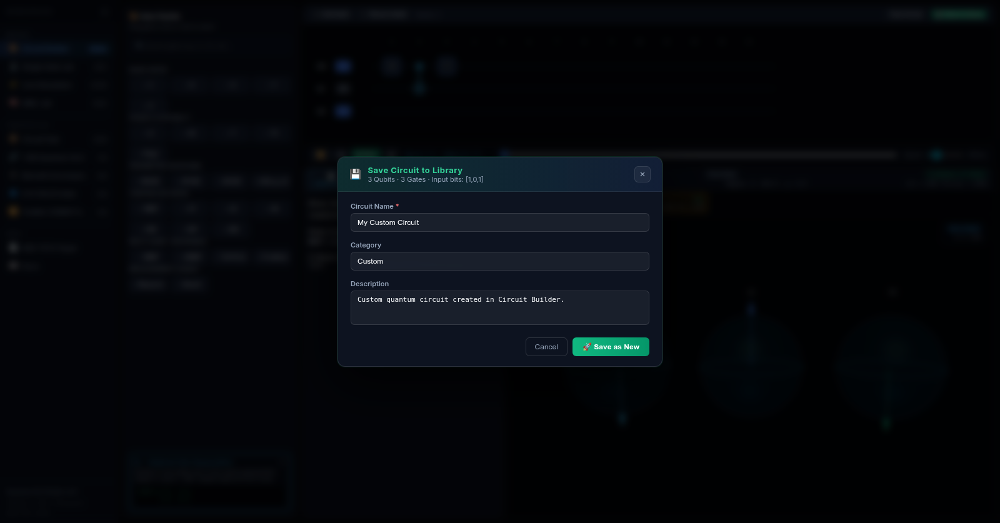
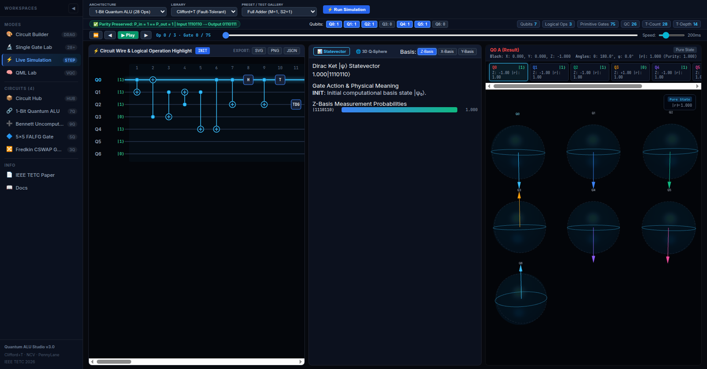
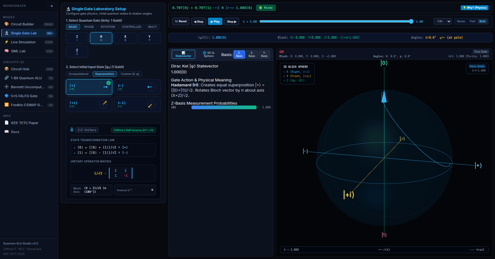
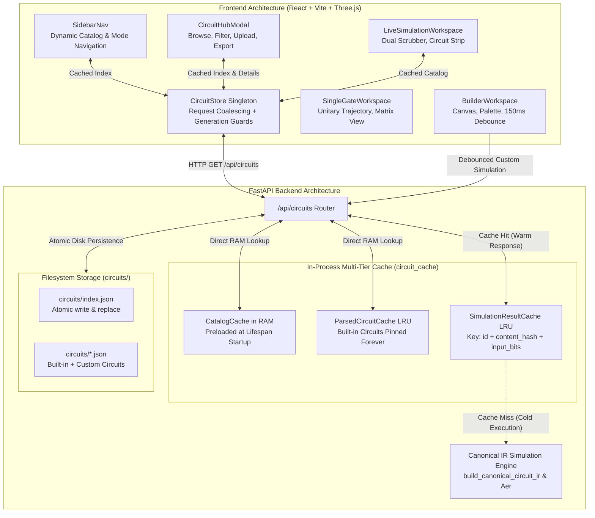

# ⚛️ Quantum ALU 3D Studio 2.0: Fault-Tolerant Parity-Preserving Clifford+T ALU

[](https://www.python.org/)
[](https://qiskit.org/)
[](https://fastapi.tiangolo.com/)
[](https://vitejs.dev/)
[](https://threejs.org/)
[]()
[]()

> **IEEE Transactions on Emerging Topics in Computing (TETC 2026) Paper Replication & Interactive 3D WebGL Workbench:**  
> **"A New Quantum Efficient Fault Tolerant Parity Preserving Clifford + T ALU"**  
> *Shekoofeh Moghimi, Mohammad Reza Reshadinezhad, and Antonio Rubio (2026)*  
> **DOI:** [10.1109/TETC.2026.3696481](https://doi.org/10.1109/TETC.2026.3696481) | **IEEE Xplore:** [Document 11543196](https://ieeexplore.ieee.org/document/11543196)

---

## 🎯 Executive Overview

**Quantum ALU 3D Studio 2.0** is an interactive, full-stack microarchitecture workbench and verification environment for fault-tolerant reversible quantum computing.

Unlike conventional circuit visualizers that treat quantum circuits as flat, ephemeral gate lists, Quantum Studio 2.0 provides:
1. **Decoupled JSON Circuit Storage & Library Hub**: All circuits live in standalone, human-readable JSON files (`circuits/*.json`) indexed via a central registry (`circuits/index.json`), supporting dynamic cataloging, search, filtering, and drag-and-drop uploads.
2. **Complete Custom Circuit Lifecycle**: Built-in benchmark circuits are protected as immutable read-only assets, while user-authored custom circuits can be created in the Circuit Builder, simulated, exported, updated, or saved as new variants.
3. **Dual-Level Execution Stepping**: Step forward and backward through high-level ALU logical operations (e.g. *Op 2: Full Adder*) as well as underlying primitive Clifford+T gates ($1 \to 75$).
4. **Real-Time Physics Visualizers**: Interactive Three.js WebGL 3D Bloch sphere arrays, continuous unitary Bloch vector trajectory tracking, IBM 3D Q-Sphere statevector mapping, and online parity preservation ($P_{\text{in}} = P_{\text{out}}$) error detection.
5. **In-Process Acceleration Layer**: Multi-tier caching (`CatalogCache`, bounded `ParsedCircuitCache` LRU, and content-addressed `SimulationResultCache`) delivering **~11x–15x simulation speedups** for repeat executions and eliminating duplicate network fetches through frontend request coalescing and 150 ms debouncing.

---

## 📸 Interactive Studio Workspaces & Visual Walkthrough

### 1. 🎨 Interactive Circuit Builder Workspace
Create and edit arbitrary quantum circuits across multiple qubit wires. Placed gates update the real-time Dirac ket statevector $|\psi\rangle$, measurement probabilities, and 3D Bloch spheres live in-place.


*Figure 1: Circuit Builder with searchable 28+ gate palette, multi-qubit control-target wiring, real-time Dirac statevector $|\psi\rangle$, 3D WebGL Bloch spheres, and the "Save to Library" action.*

---

### 2. 📦 Quantum Circuit Library Hub
Browse indexed benchmark and custom circuits with comprehensive metadata: qubit counts, gate counts, quantum costs ($QC$), $T$-count, $T$-depth, fault-tolerant synthesis type, and paper citations.


*Figure 2: Quantum Circuit Library Hub showing indexed system built-ins and custom circuits, category filtering, quantum cost metrics, and direct execution actions.*

---

### 3. 📥 Drag-and-Drop JSON Upload & Pre-flight Validation
Upload custom quantum circuit JSON files with server-side pre-flight validation enforcing gate whitelisting, qubit boundary constraints ($[0, n-1]$), and path traversal immunity.


*Figure 3: Secure circuit upload tab with drag-and-drop zone and authoritative schema validation.*

---

### 4. 💾 Custom Circuit Lifecycle & "Save to Library"
Save circuits authored in the Circuit Builder directly to the library. The interface enforces immutability on system benchmarks while enabling continuous updates or "Save as New" branching on custom circuits.


*Figure 4: Save Circuit Modal preserving gate orders, parameters, qubit allocations, and input bit initializations.*

---

### 5. ⚡ Live Simulation / ALU Laboratory Workspace
Execute full ALU microarchitectures step-by-step. The live workspace provides dual-level transport scrubbing (Logical Ops vs Primitive Gates), online parity verification ($P_{\text{in}} == P_{\text{out}}$), Dirac statevector expansion, and an array of 3D Bloch spheres.


*Figure 5: Live Simulation of the 1-Bit Quantum ALU (7 qubits, 75 Clifford+T gates) showing the active gate step, parity preservation confirmation, and individual qubit Bloch vectors.*

---

### 6. 🔬 Single-Gate Physics Laboratory
Explore single-qubit quantum physics with continuous Bloch vector trajectory animation, mathematical state transformation laws, unitary operator matrices, and parametric rotation angles ($\theta \in [0, 2\pi]$).


*Figure 6: Single Gate Lab visualizing Hadamard gate superposition creation, continuous rotation trajectory curve, and unitary matrix representation.*

---

## 🏛️ System Architecture



---

## ⚡ Performance Acceleration & Caching Benchmarks

Empirical profiling revealed that **97.4% of simulation execution latency** was spent computing step-by-step statevectors and partial-trace density matrices inside `build_canonical_circuit_ir` (~214 ms for 1-Bit ALU, ~825 ms for 9-qubit Bennett Adder). 

Phase 5 introduced in-process caching, content hashing, and frontend coalescing to accelerate repeat operations:

| Operation | Un-Cached Baseline | Accelerated Runtime | Speedup / Impact |
|---|---|---|---|
| `GET /api/circuits` (Catalog index) | 5.11 ms (disk read) | **< 0.01 ms** (RAM) / **1.80 ms** (HTTP) | Direct memory pointer lookup |
| `GET /api/circuits/{id}` (Circuit Detail) | 6.24 ms (disk read) | **< 0.02 ms** (RAM) / **2.56 ms** (HTTP) | Pinned memory / bounded LRU |
| **Warm Simulation (Identical Circuit & Inputs)** | **224.64 ms** | **< 0.05 ms** (RAM) / **~15–20 ms** (HTTP) | **~11x–15x faster roundtrip** |
| Circuit Hub Opening & Tab Switching | 3 concurrent HTTP fetches | **1 coalesced HTTP fetch** | **66% network reduction** |
| Circuit Hub Details Switching (Re-selected) | Network fetch on click | **Instant (0 ms network)** | Shared client store hit |
| Builder Rapid-Edit Simulation (3 consecutive gates) | 3 un-debounced POSTs | **1 coalesced debounced POST** | **66% request reduction + race-free** |

---

## 📊 IEEE TETC 2026 Paper Replication Results

All 6 core mathematical claims of the IEEE Transactions on Emerging Topics in Computing paper were fully reproduced and verified:

| Verification Target | Paper Claim | Experimental Replication Result | Status |
| :--- | :--- | :--- | :--- |
| **Table IV: 5x5 FALFG Gate** | 32 Truth Table States | **32 / 32 Matched** (Clifford+T & NCV decompositions) | `100% MATCH` |
| **Table V: FALFG Functions** | 24 Reversible Functions | **24 / 24 Verified** (Arithmetic + Logic) | `100% MATCH` |
| **Table VI: 1-Bit ALU Operations** | 28 ALU Operations | **28 / 28 Verified** ($M=0$ Logic, $M=1$ Arithmetic) | `100% MATCH` |
| **Parity Preservation** | $P_{\text{in}} = P_{\text{out}}$ | **Strictly Preserved** across all valid ALU operations | `VERIFIED` |
| **Reversibility** | $U^\dagger U = I$ | **True** (Bijective state mapping without information loss) | `VERIFIED` |
| **Figure 9: Bennett Adder** | Zero Garbage Uncomputation | **9 Qubits, 0 Garbage Outputs** via uncomputed restoration | `VERIFIED` |
| **Table IX: 4-Bit Scaling** | $QC=128, \text{Delay}=71, G=15, T=109$ | **Formula & synthesized circuit match Table IX** | `100% MATCH` |

---

## 📁 Repository Structure

```text
.
├── dev.sh                              # Fast multi-service launcher (FastAPI :8000 + Vite :5173)
├── verify_paper.sh                     # Master paper mathematical replication script
├── SYMBOLS.md                          # Living Symbol Catalog of all public APIs and components
│
├── circuits/                           # Standalone JSON Circuit Storage
│   ├── index.json                      # Master circuit catalog registry
│   ├── 1_bit_alu_clifford_t.json       # Built-in 1-Bit ALU (7Q, 75 gates, Clifford+T)
│   ├── falfg_5x5.json                  # Built-in 5x5 FALFG Function Generator (5Q, 24 gates)
│   ├── fredkin_cswap.json              # Built-in Fredkin CSWAP Gate (3Q, 17 gates)
│   └── bennett_adder.json              # Built-in Bennett Uncomputed Adder/Subtractor (9Q, 52 gates)
│
├── backend/app/                        # Modular FastAPI Backend
│   ├── main.py                         # Lifespan hot boot and application root
│   ├── api/
│   │   └── circuits.py                 # REST API (/api/circuits catalog, upload, simulate, delete)
│   ├── core/
│   │   ├── circuit_storage.py          # Atomic persistence, validation, and Qiskit converters
│   │   └── circuit_cache.py            # Multi-tier in-process cache manager & content hasher
│   ├── schemas/
│   │   └── circuit_file.py             # Pydantic schemas (CircuitFileSchema, CircuitIndexSchema)
│   ├── gates/                          # Primitive quantum gates and Clifford+T library
│   ├── modules/                        # Reversible ALU, FALFG, and Bennett modules
│   └── simulation/                     # Verifier, Cost Metrics, Bloch Adapter, and Aer engine
│
├── frontend/                           # Modern Vite + React + TypeScript 3D WebGL Frontend
│   ├── src/
│   │   ├── components/                 # UI components
│   │   │   ├── builder/                # CircuitBuilder, CircuitCanvas, GatePalette, SingleGateLab
│   │   │   ├── modals/                 # CircuitHubModal, SaveCircuitModal, PaperModal, DocsModal
│   │   │   ├── workspaces/             # LiveSimulationWorkspace (ALU Stepper & Visualizer)
│   │   │   └── SidebarNav.tsx          # Dynamic collapsible sidebar with catalog counter
│   │   ├── services/
│   │   │   ├── api.ts                  # Backend REST API client
│   │   │   ├── circuitStore.ts         # Shared client cache singleton with request coalescing
│   │   │   └── gateRegistry.ts         # 28+ quantum gate definitions and unitary formulas
│   │   └── types/                      # TypeScript schemas (circuit.ts, simulation.ts, mode.ts)
│   └── package.json
│
├── tests/                              # Comprehensive Automated Test Suites
│   ├── test_circuit_storage.py         # Storage, traversal security, and semantic validation tests
│   ├── test_circuit_api.py             # REST API endpoint and upload tests
│   ├── test_circuit_lifecycle.py       # Custom circuit create, update, delete, and immutability tests
│   ├── test_phase5_performance.py      # Cache hit/miss, deepcopy, and LRU eviction tests
│   ├── test_e2e_chrome.py              # Automated Chrome DevTools E2E and visual snapshot suite
│   ├── test_e2e_selenium.py            # Headless Chrome state isolation and multi-hop tests
│   └── test_*.py                       # Mathematical truth table, parity, and fidelity unit tests
│
└── docs/images/                        # High-resolution screenshots captured by Chrome DevTools
```

---

## 🚀 Quickstart & Usage

### 1. Launch the Studio Workbench
Run `./dev.sh` to launch both backend and frontend servers with hot reloading:

```bash
./dev.sh
```

- **Frontend Workbench**: **http://localhost:5173**
- **FastAPI Backend**: **http://localhost:8000** *(Interactive Swagger docs at `http://localhost:8000/docs`)*

---

### 2. Run Automated Chrome DevTools E2E & Snapshot Suite
Executes end-to-end user journeys using headless Google Chrome with Chrome DevTools Protocol logging, verifies DOM elements, audits console errors, and captures fresh UI screenshots in `docs/images/`:

```bash
python3 tests/test_e2e_chrome.py
```

---

### 3. Run Backend Python Test Suites
Run all 74 unit, integration, lifecycle, and performance tests:

```bash
PYTEST_DISABLE_PLUGIN_AUTOLOAD=1 python3 -m pytest tests/test_circuit_storage.py tests/test_circuit_api.py tests/test_circuit_lifecycle.py tests/test_phase5_performance.py tests/test_falfg.py tests/test_one_bit_alu.py tests/test_uncomputation.py -v
```

---

### 4. Build Frontend for Production
Run TypeScript compiler check and Vite production bundling:

```bash
cd frontend && npm run build
```

---

## 📜 Citation

If you use this software, the replicated ALU microarchitectures, or the verification testbenches in your research, please cite the published IEEE paper:

```bibtex
@ARTICLE{11543196,
  author={Moghimi, Shekoofeh and Reshadinezhad, Mohammad Reza and Rubio, Antonio},
  journal={IEEE Transactions on Emerging Topics in Computing}, 
  title={A New Quantum Efficient Fault Tolerant Parity Preserving Clifford + T ALU}, 
  year={2026},
  volume={14},
  number={2},
  pages={718-733},
  keywords={Circuits;Design methodology;Adders;Logic;Quantum circuit;Arithmetic;Costing;Costs;Delays;Measurement unit},
  doi={10.1109/TETC.2026.3696481}
}
```
